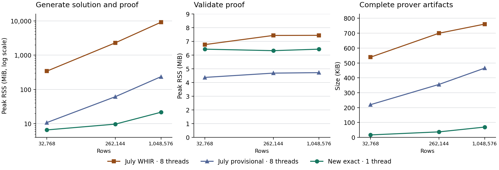

# Matched July tridiagonal benchmark

Every protocol here used the July public problem at each row count. The matrix has $1/2$ on the diagonal and $1/16$ on the two adjacent diagonals, with the ends truncated. The RHS uses the original seeded dyadic generator and fixed nonce. For the C comparison profile, the signed start selects this fixture and the commitment timestamp still provides fresh entropy. The fixed problem makes the experiment repeatable.

## One million rows at one thread

The original WHIR process peaked at **9,132.58 MiB** while solving and proving. The equivalent peak across the three C processes was **21.61 MiB**, or approximately **423× lower**. With the solution already supplied, the new commit/prove peak was **6.66 MiB**. The exact transcript shrank from **779,326 to 70,604 bytes**, a **90.94% reduction**. The C proof contains both authenticated timestamps.

| Protocol | Generate peak RSS, MiB | Validate peak RSS, MiB | Generate wall, s | Validate wall, s | Complete bytes |
|---|---:|---:|---:|---:|---:|
| July WHIR exact | 9,132.58 | 7.55 | 961.45 | 0.01 | 779,326 |
| July floating provisional | 235.24 | 4.81 | 17.64 | <0.01 | 480,384 |
| Shared-exponent C exact | 21.61 | 6.43 | 2.66 | 0.812 | 70,604 |

Generation wall time combines the solver, commitment and proof work performed by each implementation. It excludes issuer work, external transport and the independent correctness oracle. The C time is the median of three stage-time sums. July timing uses GNU time with hundredth-second resolution. The old exact prover wrote byte-identical files at one and eight threads. The old fast runs used different one-shot nonces. [One-thread July measurements](old-1thread.json)

## Scaling at the published thread setting

The table uses one July release run per protocol and size with the published eight-thread Rayon setting. C figures are medians of three single-thread runs. Generation includes solving. Each cell in the final column is the measured artifact size on disk.

| Rows | Protocol | Generation peak RSS, MiB | Validation peak RSS, MiB | Complete bytes |
|---:|---|---:|---:|---:|
| 32,768 | July WHIR exact | 341.55 | 6.76 | 551,670 |
| 32,768 | July floating provisional | 10.79 | 4.37 | 224,872 |
| 32,768 | Shared-exponent C exact | 6.58 | 6.43 | 16,716 |
| 262,144 | July WHIR exact | 2,287.18 | 7.43 | 716,630 |
| 262,144 | July floating provisional | 61.37 | 4.68 | 364,240 |
| 262,144 | Shared-exponent C exact | 9.71 | 6.32 | 37,580 |
| 1,048,576 | July WHIR exact | 9,132.61 | 7.43 | 779,326 |
| 1,048,576 | July floating provisional | 235.47 | 4.71 | 476,224 |
| 1,048,576 | Shared-exponent C exact | 21.61 | 6.43 | 70,604 |



The WHIR proof lengths at all three sizes exactly reproduced the blog. At one million rows the July provisional proof varied with the new challenge nonce. The measured total was 476,224 bytes, including the 204-byte precommitment. The archived blog artifacts total 479,136 bytes.

## Current prover stages

All sizes below used the same C executable and proof format. RSS and times are per-stage medians. The final column includes the 352 bytes of receipts.

| Rows | Solve MiB | Commit MiB | Prove MiB | Verify MiB | Commit s | Prove s | Verify s | Proof bytes |
|---:|---:|---:|---:|---:|---:|---:|---:|---:|
| 1,024 | 5.86 | 6.13 | 6.45 | 6.40 | 0.022 | 0.022 | 0.013 | 5,836 |
| 2,048 | 5.88 | 6.11 | 6.68 | 6.30 | 0.032 | 0.028 | 0.017 | 6,988 |
| 4,096 | 5.86 | 6.10 | 6.57 | 6.45 | 0.039 | 0.029 | 0.025 | 8,140 |
| 8,192 | 5.97 | 6.05 | 6.54 | 6.38 | 0.049 | 0.040 | 0.030 | 10,316 |
| 16,384 | 5.98 | 6.12 | 6.57 | 6.31 | 0.045 | 0.056 | 0.028 | 12,492 |
| 32,768 | 6.16 | 6.14 | 6.58 | 6.43 | 0.064 | 0.081 | 0.048 | 16,716 |
| 65,536 | 6.59 | 6.23 | 6.42 | 6.39 | 0.100 | 0.142 | 0.074 | 20,940 |
| 131,072 | 7.73 | 6.23 | 6.64 | 6.55 | 0.202 | 0.246 | 0.134 | 29,260 |
| 262,144 | 9.71 | 6.15 | 6.53 | 6.32 | 0.302 | 0.452 | 0.238 | 37,580 |
| 524,288 | 13.49 | 6.04 | 6.40 | 6.53 | 0.593 | 0.867 | 0.414 | 54,092 |
| 1,048,576 | 21.61 | 6.22 | 6.66 | 6.43 | 0.906 | 1.715 | 0.812 | 70,604 |

The smallest tested size where the median C prover used less RSS than the C Thomas solver was 65,536 rows. At 32,768 rows the solver used 6.16 MiB and proving used 6.58 MiB. At one million rows solving used 21.61 MiB and proving used 6.66 MiB. At that size the transcript is 0.842% of a binary64 solution.

The million-row C proof uses a 1,024 × 1,024 commitment layout. Its row commitments and folded opening take 65,536 bytes combined, the two 20-round sumchecks take 2,560 bytes, and the remaining fields take 2,508 bytes. Their sum is the verified file length of 70,604 bytes.

[Raw July eight-thread results](old-results.json) · [Raw C measurements and integer-oracle checks](new-results.json) · [New million-row proof](public/proof.bin) · [July WHIR million-row proof](public-july/proof.ssp)

## What was held constant

The original Rust solver performed the Thomas solve and rounded to Q63.64. The C solver used the same recurrence and rounding. A separate program linked to the July Rust solver exported its integer coordinates. The harness compared every coordinate with the C solution at every measured size. It also regenerated the RHS and independently accumulated the residual and solution energies with Python integers. Only the public inputs and the proof entered the timed validator. [Published benchmark](https://www.reidatcheson.com/sparse%20linear%20algebra/zero%20knowledge%20proof/validated%20computing/snark/stark/2026/07/15/validated-solution.html) · [Pinned July implementation](https://github.com/ReidAtcheson/sparse-solution-stark/tree/be8b67b74da54d162df2e6e0a9d813779959bb60)

For $n=1{,}048{,}576$, both exact validators certified the same physical squared residual. July reported $300681894297600/2^{136}$. The C encoder selected $E=1$ and reported $20178420351680013926400/2^{162}$. These are equal as rational numbers. The private binary64 solution occupied 8 MiB. Its SHA-256 was `5b8ccc28aa57052dd40da758a62afcc4cbcb3656e2dc3853918cc13a94c29cb7`.

## Measurement boundaries

The July exact prover runs its solver and WHIR prover in one process. The C pipeline runs solve, commit, and prove sequentially as separate processes. Compare the July prover's peak with the **maximum** of the three C stage peaks to include solving. The maximum of commit and prove separately describes a prover supplied with a private solution. The verification figures are fresh-process high-water marks. The Linux measurements use KiB from GNU time or `wait4.ru_maxrss`, divided by 1024 for MiB.

The July exact certificate also proves digit ranges for its Q63.64 witness and residual. The C proof uses randomized subset checks and an authenticated solution energy to lift the same physical score to the integers. The matching score provides a common numerical claim across the two proof systems.

The C prover spills at most one full table of 32 bytes per row to an unlinked scratch file on ext4, in addition to a small proof-publication staging file. The million-row scratch table is 32 MiB. Kernel file cache is outside process RSS. The July exact validator uses a structured matrix endpoint and periodic RHS evaluation. The C validator regenerates every row, keeping approximately square-root-sized weight tables in memory. The July fast path produces a provisional floating-point consistency proof. Its reported transport includes both the proof file and the separate 204-byte precommitment retained by the issuer. The new proof file includes both signed receipts.

## Comparison profile arithmetic

The generator emits $M=16A$ and integer codes $B=256b$, with $|B_i|\le207$. With $x=2^{E-78}X$, the integer residual is $R=MX-2^{74-E}B$ and the physical residual is $2^{E-82}R$. This explains the different integer numerators and permits an exact cross-check. The validator also reports a certified upper bound on the joint 2-norm backward error. It uses the Rayleigh quotient $(10-2/n)/16$ as a lower bound on the true matrix norm. The reported squared residual is exact.

The comparison profile admits $-26\le E\le54$ and $n\le 2^{30}$. The shared-exponent range proof lifts $Q=\sum_j X_j^2$ to an integer and enforces $Q\le n2^{156}$. Since $\|M\|_2\le10$ and $74-E\le100$, $\|R\|_2\le10\sqrt Q+2^{100}207\sqrt n<2^{124}$. Thus the squared residual also fits in the scalar field.

## Reproduce

Build `stencil` with `make`. The July commands require the pinned Rust checkout with its release binaries. The C oracle uses that checkout and its cached Rust dependencies. On Linux, run from this source directory using a disk-backed scratch filesystem.

```sh
july=/path/to/sparse-solution-stark
(cd "$july" && cargo build --release --locked -p sparse-stark-prover -p sparse-stark-validator)
python3 benchmarks/blog-comparison/run_july.py "$july" /tmp/july-eight /tmp/july-eight.json --threads 8
python3 benchmarks/blog-comparison/run_july.py "$july" /tmp/july-one /tmp/july-one.json --threads 1 --dimensions 1048576
python3 benchmarks/blog-comparison/run_new.py --july-repo "$july" --trials 3 --july-results /tmp/july-eight.json --scratch-dir /tmp --output /tmp/july-c.json --public-dir /tmp/july-c-public
./stencil verify /tmp/july-c-public/authority.pub /tmp/july-c-public/proof.bin /tmp/july-c-public/start.receipt
```

To replay the saved July exact proof without generating a new one, run the following from the source directory with the same `july` path.

```sh
p=benchmarks/blog-comparison/public-july
"$july/target/release/sparse-validator" verify --problem "$p/problem.json" --proof "$p/proof.ssp"
```
